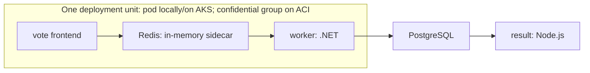

# Radius: one app, three targets

Deploy one unchanged Radius application definition, `app.bicep`, to three targets: local Kubernetes, Azure Kubernetes Service (AKS), and confidential Azure Container Instances (ACI). Only the platform configuration differs between targets. Numbered scripts take you through preparation, the three deployments, and a final verification. Each step has two equivalent command tracks: **PowerShell on Windows** or **Bash on Linux, WSL, and macOS**.

Choose one track and host for a complete run. Both tracks use the same application, image lock, platform files, and seven-setting `config.json`, including an explicit `TenantId`. The Bash track is native Bash with `jq`, `curl`, and `openssl`; it does **not** call PowerShell or a separate scripting-language helper.

**Simplification:** Redis stays beside `vote` and `worker`. AKS and ACI use Azure Database for PostgreSQL Flexible Server, not Azure-managed Redis. On ACI, all three containers in the `vote` group are confidential; `result` is standard.

**Use Cats/Dogs votes only. This is not a production deployment guide.**

## The application



Five components do not mean five Radius resources here. `vote`, `worker`, and Redis share one `Radius.Compute/containers` resource. `result` is another; `db` is a `Radius.Data/postgreSqlDatabases` resource. Sidecar traffic uses localhost; the two PostgreSQL dependencies are explicit Radius connections.

Credential values stay out of `app.bicep`. Preparation generates a separate PostgreSQL password for each environment, and each deployment passes it as a private parameter. The username `myadmin` is a fixed, nonsecret identifier shared by every target; the generated confidential policy also pins it.

| Target | Application compute | Redis | PostgreSQL |
| --- | --- | --- | --- |
| `local` | Local Kubernetes | Sidecar | In-cluster |
| `aks` | Dedicated AKS cluster, existing or bootstrapped below | Sidecar | Azure Flexible Server |
| `aci` | Confidential `vote` group; standard `result` group | Inside the confidential group | Separate Azure Flexible Server |

The two cloud environments use the Radius control plane on AKS. That does **not** mean ACI application containers run on AKS.

## Files in this sample

| File | Purpose |
| --- | --- |
| `app.bicep` | One unchanged application definition |
| `images.lock.json` | Four immutable Linux/AMD64 application/sidecar image references |
| `images/voting-app.patch`, `images/redis/Dockerfile` | Build inputs for the four images: environment-based Redis and PostgreSQL settings for the voting app source, and the Redis base image |
| `platform/local.bicep` | Local Kubernetes recipes; publishes vote and result on localhost node ports |
| `platform/cloud.bicep` | AKS/ACI recipe selection, AKS public load balancers, and Azure PostgreSQL configuration |
| `platform/kubernetes-containers.bicep` | Platform-owned Kubernetes wrapper; reuses the pinned upstream container recipe and adds each environment's NodePort or LoadBalancer Services |
| `platform/aci-containers.bicep` | Platform-owned confidential/standard selection; wraps the pinned upstream ACI recipe |
| `platform/vote-policy-template.json` | Exact `vote` group input to policy generation; no password values |
| `platform/generated/vote-policy.rego` | Human-readable policy, generated during preparation. Its container rules are one long line; `Show-Policy` prints a readable excerpt |
| `infra/main.bicep`, `infra/aks.bicep` | Optional Azure host bootstrap; separate from the Radius application/recipes |
| `infra/kind.yaml` | Single-node local kind cluster with a digest-pinned Kubernetes node image; publishes node ports 30080 and 30081 on `127.0.0.1` |

The [Build samples workflow](../../.github/workflows/build.yaml) builds the vote, worker, and result images from a pinned commit of the upstream voting app source after applying `images/voting-app.patch`. The patch reads Redis and PostgreSQL connection settings from environment variables, negotiates PostgreSQL TLS, and updates Npgsql to a patched release. The workflow also builds the Redis image from `images/redis/Dockerfile`, publishes all four as `ghcr.io/radius-project/samples/voting-app-<name>`, and lists each linux/amd64 digest in its run summary. `images.lock.json` ships with `__SHA__` placeholders: before preparation, replace each entry with the digest-pinned reference from that summary. Preparation rejects images that are not pinned by digest. The same **platform-specific image digests**, not just matching tags or a multi-platform index, are used everywhere.

The PostgreSQL implementation is deliberately different locally and in Azure. The unchanged-image claim covers the four entries in `images.lock.json`, not the local PostgreSQL implementation image or managed Azure service internals.

## Before you start

Use a dedicated demo subscription/resource scope and two dedicated demo clusters. Run every command in this guide from this sample's directory, `samples/local-aks-aci`.

### Check prerequisites and versions first

Run the read-only checker in your chosen track. It reports **detected version**, **required version**, and **OK / FAIL / WARN / SKIP**, then prints proposed install or repair commands for anything missing or incompatible. It never executes those suggestions.

```powershell
# Run in PowerShell 7, not Windows PowerShell 5.
.\scripts\Check-Prerequisites.ps1

# After the two kube contexts are configured, also query their APIs and Radius controllers:
.\scripts\Check-Prerequisites.ps1 -CheckClusters
```

```bash
bash ./scripts/Check-Prerequisites.sh
bash ./scripts/Check-Prerequisites.sh --check-clusters
```

If PowerShell 7 itself is missing on Windows, the bootstrap command is `winget install --exact --id Microsoft.PowerShell`.

The checks cover the shell, Radius CLI, Azure CLI, Docker or Podman client/engine, kubectl, kind, GitHub CLI, the `confcom` extension, and optional Bicep, AKS `kubelogin`, and Deployment Stacks what-if capability. **Standalone Bicep is required for the new Azure bootstrap; kubelogin is required to connect to its Entra-enabled AKS cluster.** They remain optional checker rows for people bringing a differently configured existing cluster. Bash also checks `jq`, `curl`, and OpenSSL/LibreSSL. With a valid configuration, the checker verifies that the selected subscription belongs to `TenantId` and that the active Azure account matches the pair. It never signs in or switches accounts automatically. The default run reads local kubeconfig context names but does not contact cluster APIs. `-CheckClusters` / `--check-clusters` additionally checks Kubernetes server versions, client/server minor-version skew, Linux/AMD64 nodes, and the ready Radius `dynamic-rp` image version.

**`radius-version.txt` is the shared exact Radius release pin**, currently `0.62.0`. Both preparation scripts read it, and the checkers compare it with the Bicep extension and `kubernetes-recipes.lock.json`. Kubernetes recipes use the published upstream commit recorded in that lock file, not the CLI version as an OCI tag. Other tools have a documented minimum where one is needed, or simply have their detected version reported. The sample checks Docker against `20.10.5` and Podman against `3.0.0`, separately, and uses kind `0.33.0` or later. These provider minima align with [kind's runtime requirements](https://kind.sigs.k8s.io/docs/user/rootless/#provider-requirements); they are not a guarantee of every demo integration. `infra/kind.yaml` pins the official kind `0.33.0` node image for Kubernetes `1.37.0` by digest, keeping the local server on the same minor version as the demo AKS cluster instead of following kind's changing default image.

**Podman behind `docker` is supported by both prerequisite checkers and policy platform checks.** Keep your existing executable, symlink, or hard link named `docker`; no runtime substitution or link change is performed. A renamed Podman executable can print `docker version 5.8.3`, so detection uses `docker version --help`, not the filename or version banner. Checks then read that provider's server metadata and require Linux/AMD64 where local execution is needed. A Windows client does not make a Linux Podman machine incompatible.

If Podman reports a refused connection, that is a backend problem, not an old Docker version. Inspect `docker info`, `docker system connection list`, and, for a managed remote machine, `docker machine list`. A machine listed as running can still have an unreachable connection. Resolve the reported endpoint/service problem before you continue; the checker never starts, restarts, resets, or recreates machines.

A CLI link does **not** configure a [Docker-compatible API socket](https://docs.podman.io/en/latest/markdown/podman-system-service.1.html) or shared registry credentials for other tools. Test `az confcom` policy generation and Radius recipe publishing separately on the chosen runtime. A passing runtime check does not establish those integrations; importing a source-matching policy bundle remains an alternative. Do not expose an unauthenticated container API to work around compatibility issues.

The Kubernetes recipe lock uses source commit `0c3eaf14e7acc074420e78fda4d66c51541a8145`, selected from the [Radius 0.62.0 release catalog](https://github.com/radius-project/radius/blob/v0.62.0/deploy/manifest/defaults.yaml). The local PostgreSQL recipe and local/AKS container recipes share this pin. Preparation verifies that both OCI artifacts are anonymously readable Bicep modules before creating resources. Changing this lock requires rerunning preparation to refresh the baseline; do not edit saved fingerprints. The existing source-matching CCE policy bundle can be reused because this lock does not change the application, images, or ACI wrapper.

Exit code `1` means a blocking prerequisite is missing or incompatible; it is an expected diagnostic on an unprepared machine. Optional warnings, such as kind being absent when you already have a suitable local cluster, do not block by themselves. Missing/inaccessible configured clusters do block when checked. A clean result is not proof of Azure/GitHub authentication, RBAC, cloud quota, registry login, or a successful deployment.

Install commands target WinGet on Windows, Homebrew on macOS, and Ubuntu/Debian for Linux package examples. For Docker on WSL, suggestions use Docker Desktop's Windows-host installation and WSL integration rather than a second daemon. A detected Podman CLI gets Podman-specific guidance instead. Review downloaded vendor installers before executing them. No software is installed by these checkers.

**Installed in another terminal, but not found here?** A running desktop app, such as VS Code, retains the PATH it inherited when it started. Opening a new external terminal does not refresh that app's environment. Fully restart the app after an installer updates your User PATH. For a temporary fix in the PowerShell terminal you will use:

```powershell
$env:PATH = "$env:LOCALAPPDATA\radius;$env:PATH"
```

The Windows checker and demo command helper also recognize the Radius installer's documented `%LOCALAPPDATA%\radius\rad.exe` location when `rad` is absent from the current process PATH. They report that location and a PATH warning; they do not change PATH, copy binaries, or override a `rad` already selected by PATH.

For an actual Docker Desktop installation, if an image pull reports `docker-credential-desktop` missing from PATH, check the existing installation instead of deleting Docker's credential-store settings. This is not a Podman installation step. For the standard Windows installation, after confirming the helper exists:

```powershell
Test-Path "$env:ProgramFiles\Docker\Docker\resources\bin\docker-credential-desktop.exe"
$env:PATH = "$env:ProgramFiles\Docker\Docker\resources\bin;$env:PATH"
```

This changes only the current terminal's PATH. Restarting the terminal/app after Docker Desktop installation also refreshes its inherited environment; stored Docker credentials and registry logins should be retained.

**A failed version command is not proof that a package is missing.** Both checkers now show a bounded diagnostic and distinguish access-denied errors from missing installations. For example, `az extension show` can fail while reading an installed `confcom` metadata directory. In that case, the extension remains blocked until the current account/application has legitimate read access. Have the reported folder's access reviewed by its owner or IT; do not grant broad permissions, switch to an unauthorized account, or repeatedly reinstall based on that message. The prerequisite checker changes no folder permissions; setup restricts only its own private demo state.

Azure CLI can also return `metadata: null` and `version: null` with a successful exit code: some metadata-loading exceptions are logged only at debug level. The checkers inspect the full extension JSON and mark that result as unavailable, not installed successfully. Run `az extension show --name confcom --output json --debug` in the affected terminal and inspect the metadata exception before choosing a repair. An error observed in one app or terminal is not proof that another terminal has the same error.

### Choose your host

| Host | Command track | Confidential-policy preparation |
| --- | --- | --- |
| Windows | PowerShell 7: `.ps1` | Generate with a Linux/AMD64 engine and working `az confcom` integration, or import a bundle |
| Linux / WSL | Bash 3.2+, `jq`, `curl`, `openssl`: `.sh` | Generate with Linux `az confcom` and a compatible Linux/AMD64 engine, or import a bundle |
| macOS, Intel or Apple Silicon | Bash 3.2+, `jq`, `curl`, `openssl`: `.sh` | Import the source-matching bundle generated on Linux/WSL or Windows |

**Workstation architecture and cluster architecture are different.** Your shell may run on an ARM64 Mac, but both Kubernetes targets must have Linux/AMD64 nodes to preserve the exact locked digests. On Apple Silicon, use an existing AMD64 development VM/cluster instead of creating native ARM64 kind nodes. The `local` environment is the development target; it can also be a remote development cluster.

| Requirement | Detail |
| --- | --- |
| Windows track | PowerShell 7.2+; DPAPI protects Windows credential backups |
| Linux/WSL/macOS track | Bash 3.2+, `jq`, `curl`, and `openssl`; private native-home storage with 0700/0600 permissions, not encryption |
| Radius CLI and both control planes | The exact release in `radius-version.txt`: **0.62.0**, matching the sample's 0.62 types; Kubernetes recipes use the separate release-catalog commit in `kubernetes-recipes.lock.json` |
| Docker-compatible CLI | Docker or Podman exposed as `docker`. Sign in to GHCR before publishing the wrapper; verify Radius can use those registry credentials. Policy generation needs a running **Linux/AMD64** engine and working `az confcom` integration, unlike bundle import |
| Azure CLI and `confcom` | Azure CLI on every host; install `confcom` explicitly on the Windows/Linux policy-generation host |
| `kubectl`, `kind`, and `gh` | kind is the default local-cluster bootstrap; `gh` is used for the documented registry login |
| AKS host | Use the Bicep bootstrap below, or bring a dedicated Linux/AMD64 AKS cluster and usable kube context |
| Azure permissions | Contributor alone is insufficient for setup: you need role-definition/assignment permissions in `SubscriptionId`, such as subscription Owner, plus permission to create an Entra application/service principal in `TenantId` |
| Azure capacity | A region/subscription supporting Confidential ACI, the preview NGroups API, and PostgreSQL `Standard_D2ds_v5`; `eastus2` is a tested choice, not a quota guarantee |
| GHCR account | Permission to publish the two demo platform recipes into one package and make that package public; no private registry credentials are configured on Radius |

Preparation does not install tools or upgrade existing clusters. Install the pinned CLI using the [Radius installation instructions](https://docs.radapp.io/installation/). In WSL, install and sign in to the **Linux** tools inside your chosen distribution; do not mix Windows `.exe` CLIs or Windows credential state into the Linux track. Git Bash on Windows is not WSL.

### Create the local cluster with kind

kind runs Kubernetes in containers, using Docker or its native Podman provider. The checked-in `infra/kind.yaml` creates one control-plane node, which also runs this demo's workloads, and publishes node ports 30080 and 30081 on `127.0.0.1`. The local recipe pack exposes vote and result on those node ports, so the apps open at `http://127.0.0.1:30080` and `http://127.0.0.1:30081` without port-forwarding. No separate worker, Kubernetes VM, or built-in Traefik is needed. Contour's `LoadBalancer` service can show an external IP of `<pending>` on kind; that is expected without an additional load-balancer provider, and this demo does not use it.

kind applies port mappings only when it creates a cluster. **A cluster created from an older `infra/kind.yaml` has no app port mappings:** delete it with `kind delete cluster --name radius-demo`, recreate it with the commands below, reinstall the pinned Radius release, rerun preparation, and redeploy. That removes the local app and its votes. Another local AMD64 cluster can be used only if it also makes those node ports reachable on `127.0.0.1`.

Use these proposed commands only after installing the pinned Radius CLI and making the selected Linux/AMD64 container engine reachable. Cluster creation writes kubeconfig and switches its current context; the prerequisite checker does neither.

**For Podman only**, make `podman` itself available on PATH and select kind's native provider in the same terminal before running kind commands:

```powershell
$env:KIND_EXPERIMENTAL_PROVIDER = 'podman'
```

```bash
export KIND_EXPERIMENTAL_PROVIDER=podman
```

Renaming Podman to `docker` does not select kind's Podman provider. Provider selection also does not migrate a cluster created on Docker into Podman's container store. Inspect existing clusters in their original runtime before creating a replacement with the same name. Rootless Podman additionally needs [kind's cgroup and host configuration](https://kind.sigs.k8s.io/docs/user/rootless/); the scripts do not change host settings.

Then, on the selected runtime:

```powershell
# Only if this named local cluster does not already exist:
kind create cluster --name radius-demo --config .\infra\kind.yaml --wait 120s

# Do this only on a dedicated local cluster that needs Radius installed.
rad install kubernetes --kubecontext kind-radius-demo

# Local CLI extension installation does not select an Azure tenant.
az extension add --name confcom
```

```bash
# Only if the named cluster does not exist and the selected engine is Linux/AMD64:
kind create cluster --name radius-demo --config ./infra/kind.yaml --wait 120s
rad install kubernetes --kubecontext kind-radius-demo

# Local installation on the Linux policy-generation host; no tenant is selected here.
az extension add --name confcom
```

The generated local kube context is **`kind-radius-demo`**, the default in `config.example.json`. Do not recreate an existing cluster with this name. A different suitable AMD64 Kubernetes cluster can still be used by setting its actual context in your private configuration. The scripts reject ARM64 **nodes** instead of silently changing images.

When migrating an existing checkout, change only `LocalContext` after the replacement is ready; keep tenant/subscription and AKS settings intact. A saved `setup-config.json` must agree with that explicitly authorized context change. Old local deployment receipts must not be reused, and an existing preparation baseline requires a fresh `00-prepare` and redeployment rather than edited hashes. New checkouts simply use the example. Deleting a local cluster destroys its local workloads and storage; remove only identified demo clusters, never all container-runtime resources.

## One-time preparation

### 1. Fill in the seven settings

Create your private configuration from the example:

```powershell
if (-not (Test-Path .\config.json)) { Copy-Item .\config.example.json .\config.json }
notepad .\config.json
```

```bash
[[ -f ./config.json ]] || cp ./config.example.json ./config.json
# Edit config.json with your preferred editor.
```

| Setting | Meaning |
| --- | --- |
| `TenantId` | GUID of the Microsoft Entra directory that owns the target subscription. For a guest account, use the resource tenant, not your home tenant. |
| `SubscriptionId` | GUID of the enabled Azure subscription in that tenant for the optional AKS bootstrap and demo data/ACI resources. |
| `Location` | A confirmed region, initially `eastus2`. |
| `LocalContext` | Your development Kubernetes context, normally `kind-radius-demo`. |
| `AksContext` | Kubeconfig context for this tenant's dedicated AKS/Radius control plane. For a new bootstrap, choose the future alias now, normally `radius-demo-aks`; it does not need to exist yet. |
| `Prefix` | A short, unused resource-name prefix for this setup. |
| `RecipeRepository` | A lowercase package path such as `ghcr.io/YOUR_OWNER/radius-demo/aci-containers`; replace the owner with your account. |

`TenantId` is required; scripts do not infer it from an ambient Azure CLI login. Tenant and subscription GUIDs are configuration, not credentials. `config.json` is ignored by Git and must not contain tokens or passwords. PowerShell can still read an older `config.psd1` when it is the only active configuration, but it must also define `TenantId`. To migrate, copy its values to JSON, add the target tenant, and move the old file out of the checkout; do not leave both active.

Commands below use `bash script.sh`, so Unix executable bits are not required. The repository's `.gitattributes` pins LF line endings for portable scripts and source hashes. If a copied `.sh` has CRLF, obtain a fresh LF checkout before you run it.

### 2. Sign in to the configured Azure tenant and subscription

Run these commands in the same shell/account/profile that will run the demo. Interactive login can require MFA. For guest accounts, authenticate explicitly against the resource directory.

```powershell
$config = Get-Content .\config.json -Raw | ConvertFrom-Json
az login --tenant $config.TenantId
az account set --subscription $config.SubscriptionId
az account show --subscription $config.SubscriptionId --query '{tenantId:tenantId,subscriptionId:id,state:state}' --output table
```

```bash
tenant_id="$(jq -er .TenantId ./config.json)"
subscription_id="$(jq -er .SubscriptionId ./config.json)"
az login --tenant "$tenant_id"
az account set --subscription "$subscription_id"
az account show --subscription "$subscription_id" --query '{tenantId:tenantId,subscriptionId:id,state:state}' --output table
```

The scripts verify **both** the explicitly selected subscription and the active account. Azure CLI's Microsoft Graph-backed `az ad` commands are tenant-level operations: they use the active account and do **not** accept `--subscription`. The wrappers therefore omit that flag for `az ad` while rechecking the configured tenant/subscription pair before every directory call. A mismatch stops the run before creating, reusing, or deleting an identity. Resource commands retain the explicit `--subscription`, and RBAC operations also recheck the context. The scripts never call `az login` or `az account set` on your behalf.

**Multiple tenants:** one configuration/run targets one tenant/subscription pair. Use a separate checkout/private state and dedicated Radius control plane for each tenant. Radius 0.62 has one default Azure credential per control plane; the scripts refuse to overwrite another tenant's or another setup's identity. AKS and ACI may share a control plane within the same demo/tenant, as this sample does.

Do not run concurrent tenant operations against the same Azure CLI login profile, because another terminal can change its default account. Use separate, approved Azure CLI profiles (`AZURE_CONFIG_DIR`) or separate execution hosts for concurrency; scripts honor the selected profile and do not copy token caches or change extension permissions. Parallel runs also need separate hosts/VMs because the local node ports are fixed.

On a shared kubeconfig, use distinct prefixes and context names for different tenants, or separate `KUBECONFIG` files. An `az aks get-credentials --context` alias alone does not rename the underlying cluster/user entries. Never approve overwriting an unrelated entry.

Saved identity metadata binds the client to its tenant and subscription. Reuse, cloud deployment, and cleanup reject mismatches. Older complete state can be validated only when its identity already records the same tenant and its saved setup records the same subscription. Incomplete/unbound state is not silently adopted: preserve it for controlled recovery or cleanup in its original directory.

### 3. Create the Azure host with Bicep, or connect an existing AKS cluster

**Skip creation if you already have a suitable dedicated AKS cluster.** The new native entry points use `infra/main.bicep` and the pinned Azure Verified Module `avm/res/container-service/managed-cluster:0.14.0`. No `azd`, extra registry, or custom scripting runtime is required.

The bootstrap creates the following in the configured tenant/subscription/location:

| Resource/configuration | Choice |
| --- | --- |
| Platform resource group | `<Prefix>-platform`, tagged with this checkout's private ownership marker and resource tenant |
| AKS cluster | `<Prefix>-aks`, Base/Free control-plane tier |
| System node pool | Two regional (non-zonal) Linux/AMD64 `Standard_D4s_v5` nodes, 64-GB managed OS disks; shared with demo workloads |
| AKS-managed node resource group | `<Prefix>-aks-nodes`; do not precreate it |
| Identity and access | System-assigned managed identity; managed Entra authentication in `TenantId`; Azure RBAC; local accounts disabled |
| Administrator access | Cluster User and RBAC Cluster Admin roles at cluster scope, assigned to the resource-tenant operator object |
| Network | Azure CNI Overlay, Standard load balancer with one outbound public IP; public API restricted to your supplied egress CIDR |
| Extras | No ACR, Key Vault, monitoring workspace, Azure Policy add-on, ingress controller, PostgreSQL, or ACI in this bootstrap |

Two nodes with at least four vCPUs each are the documented minimum for this AKS System pool, not a production recommendation. **Free means the control plane tier, not free infrastructure.** Budget for two VMs, disks, networking, and outbound traffic. Creation requires eight available vCPUs in both the total regional quota and the selected VM-family quota (`Standard DSv5` for the default size). Plan twelve available vCPUs in each for a one-node upgrade surge; existing usage counts toward those limits. The bootstrap does not request quota increases. Capacity and the two cloud application targets still depend on regional support and quota.

A successful creation preview does not prove that future upgrades have surge capacity. `maxUnavailable` is not supported on this System pool, so it is not a substitute for obtaining the extra upgrade quota.

The single shared pool is a demo compromise. The template enables the disk CSI driver, Kubernetes patch upgrades, and node security patches; it does not claim workload isolation or production availability. If omitted, Kubernetes version uses the regional default at creation. Reruns preserve the existing version rather than requesting an upgrade.

New pools explicitly pass an empty availability-zone array rather than inheriting the AVM default of zones `1,2,3`. Zone support and restrictions vary by subscription, region, and VM size; this minimal demo does not promise availability-zone redundancy. Both scripts preserve any existing owned pool's numeric zone IDs on reruns instead of trying to change its placement. Zone migrations and automatic zone placement are outside this bootstrap.

Get your actual **public IPv4 egress address** from your approved network/VPN configuration. The script does not contact a third-party IP-discovery service. Use `/32` for one address; narrow office ranges `/24` through `/32` are also accepted, using their network address. Private, reserved, documentation, and Internet-wide ranges are rejected. AKS additionally permits its own managed outbound address. Re-run the bootstrap with the new CIDR if your public/VPN egress changes.

```powershell
$apiCidr = 'YOUR_PUBLIC_IPV4/32' # Replace before running; not your LAN or WSL address.

# Default: compile Bicep and show Azure what-if. No Azure resource creation.
.\scripts\Setup-AzureInfrastructure.ps1 -ApiServerAllowedCidr $apiCidr

# After reviewing the preview and costs; requests confirmation:
.\scripts\Setup-AzureInfrastructure.ps1 -ApiServerAllowedCidr $apiCidr -Deploy
```

```bash
api_cidr='YOUR_PUBLIC_IPV4/32' # Replace before running; not your LAN or WSL address.
bash ./scripts/Setup-AzureInfrastructure.sh --api-server-cidr "$api_cidr"
bash ./scripts/Setup-AzureInfrastructure.sh --api-server-cidr "$api_cidr" --deploy
```

The default preview uses the signed-in Azure account and may need the same deployment/role permissions as creation. It writes a local ownership marker and compiled template, but does not bind a new configuration or create Azure resources. The optional Deployment Stacks mode below creates preview-result metadata in Azure instead. Preview and deployment verify registration of `Microsoft.ContainerService`, `Microsoft.Compute`, `Microsoft.Network`, `Microsoft.ManagedIdentity`, `Microsoft.ContainerInstance`, and `Microsoft.DBforPostgreSQL`. If needed, they stop and print explicit, subscription-scoped `az provider register ... --wait` commands. Review and run those commands yourself, then repeat the preview. Neither mode installs tools, registers providers, signs in, changes the active account, or modifies kubeconfig.

The default administrator is the signed-in user **as represented in the resource tenant**, including its guest object when applicable. To grant access to a group or service principal instead, supply its resource-tenant **object ID**, not its application/client ID:

| PowerShell option | Bash option | Meaning |
| --- | --- | --- |
| `-AdminObjectId` and `-AdminPrincipalType Group` | `--admin-object-id` and `--admin-principal-type Group` | Grant access to an existing group; `User` and `ServicePrincipal` are also supported |
| `-NodeVmSize` | `--node-vm-size` | `Standard_D4s_v5` (default), `Standard_D4as_v5`, or `Standard_D4s_v6`; four-vCPU/16-GB AMD64 options for initial creation, not node-pool migration. Repeat the same option on reruns. |
| `-KubernetesVersion X.Y.Z` | `--kubernetes-version X.Y.Z` | Optional full version that is supported in your region; check `az aks get-versions` first |
| `-UseDeploymentStack` | `--use-deployment-stack` | Opt in to stack management and stored preview results; the default deployment workflow is unchanged |

If Azure cannot grant DSv5-family quota, `Standard_D4s_v6` is an explicit alternative with the same node count, CPU count, memory, and workload architecture. Check its regional SKU restrictions and its separate **Standard Dsv6 Family vCPUs** quota; a DSv5 quota increase does not cover it.

```powershell
.\scripts\Setup-AzureInfrastructure.ps1 -ApiServerAllowedCidr $apiCidr -NodeVmSize Standard_D4s_v6
# To deploy after reviewing this preview, retain -NodeVmSize and add -Deploy.
```

```bash
bash ./scripts/Setup-AzureInfrastructure.sh --api-server-cidr "$api_cidr" --node-vm-size Standard_D4s_v6
# To deploy after reviewing this preview, retain --node-vm-size and add --deploy.
```

Explicit principals are checked through Microsoft Graph in the selected resource tenant, so the caller needs permission to read that object. The caller also needs subscription deployment/resource-group permissions and permission to assign the two cluster roles, such as subscription Owner. A non-user Azure CLI login must supply the administrator explicitly. Connect as the assigned user/service principal or a member of the assigned group; provisioning permissions alone do not grant Kubernetes data-plane access. Role propagation can take several minutes after deployment.

The bootstrap refuses to adopt unowned resource groups/clusters or a preexisting orphaned node group. Once a deployment is requested and confirmed, it saves the configuration and an `azure-infrastructure.json` receipt in the existing private demo state. Keep that state on a failure: Azure can leave partially created, billable resources. Rerunning with the same owner/configuration repairs the owned deployment; changing its administrator requires a separate, reviewed RBAC change, not an implicit replacement.

#### Optional: Deployment Stacks and cleaner repeat previews

The Azure CLI notice about "Deployment Stacks What-If" is informational, not an error. To opt in for this **Azure host bootstrap only**, add the stacks flag in either track:

```powershell
.\scripts\Setup-AzureInfrastructure.ps1 -ApiServerAllowedCidr $apiCidr -NodeVmSize Standard_D4s_v6 -UseDeploymentStack
# To apply after review, retain all options and add -Deploy.
```

```bash
bash ./scripts/Setup-AzureInfrastructure.sh --api-server-cidr "$api_cidr" --node-vm-size Standard_D4s_v6 --use-deployment-stack
# To apply after review, retain all options and add --deploy.
```

Keep the VM-size option that matches your chosen or existing pool. The installed Azure CLI must expose `az stack-whatif sub create`; the prerequisite checkers report this optional capability separately from the CLI version. The bootstrap checks it before using stacks, with extension auto-install disabled. PowerShell still uses Azure CLI, not an additional Az PowerShell module.

| Behavior | Default mode | Opt-in stacks mode |
| --- | --- | --- |
| Preview | `az deployment sub what-if`; no Azure result resource | `az stack-whatif sub create`; creates a named `Microsoft.Resources/deploymentStacksWhatIfResults` resource |
| Apply, only after confirmation | `az deployment sub create` | `az stack sub create`; manages `<Prefix>-platform` at subscription scope |
| Removal policy | Existing separate cleanup | `detachAll`: removing definitions or deleting the stack does not automatically delete the managed infrastructure |
| Deny settings | None added | `none`: no deny assignments added |
| Template source | Local compiled Bicep | The same local compiled Bicep; no template-spec publishing is needed |

**Stack preview is not a completely read-only Azure operation.** It creates only the result metadata, not the stack, AKS cluster, or role assignments. Each run uses a unique result name, prints its resource ID, and saves an `azure-infrastructure-preview.json` record in private demo state. Results expire automatically after **three hours (`PT3H`)**, following the current service documentation. Azure CLI 2.91's help still displays an older retention range; do not copy its `P5D` examples.

Noise reduction uses a baseline recorded by a successful stack deployment or update. The first preview of a new stack cannot benefit from that baseline, and later previews can still contain differences requiring review. Preview results also report management changes such as detachments; this is more than a console-noise switch.

Retrieve the saved result, including property-level changes, while it is retained:

```powershell
$preview = Get-Content .\.state\azure-infrastructure-preview.json -Raw | ConvertFrom-Json
az stack-whatif sub show --subscription $preview.subscriptionId --id $preview.previewId --with-property-changes true
```

```bash
state_dir="$(bash ./scripts/demo.sh state-path)"
az stack-whatif sub show \
  --subscription "$(jq -er .subscriptionId "$state_dir/azure-infrastructure-preview.json")" \
  --id "$(jq -er .previewId "$state_dir/azure-infrastructure-preview.json")" \
  --with-property-changes true
```

The stack uses the same ownership/tenant tags as the platform group. The scripts reject foreign stacks, changed deny/unmanage policies, and stacks managing resources outside the dedicated platform group. An owned legacy deployment can be enrolled only by explicitly opting in and confirming `-Deploy` / `--deploy`. A confirmed stack deployment records `deploymentMode: stack`; later runs must retain the stacks flag, rather than silently switching back to ordinary deployments. `00-prepare`, Radius application deployments, and `99-cleanup` are unchanged.

#### Connect the host

**Connect and install Radius afterward.** Successful creation prints exact commands for your configured `AksContext`, including context-scoped `kubelogin` conversion and the selected `AZURE_CONFIG_DIR`. Run those commands yourself, inspect `kubectl get nodes`, and install the pinned Radius release only if the dedicated cluster has no Radius installation. Kubeconfig acquisition changes its current context; the bootstrap itself does not.

**`kubectl` TLS handshake timeout:** check the API hostname, DNS, TCP 443, approved proxy/VPN path, and the cluster's `apiServerAccessProfile.authorizedIpRanges` before changing authentication. A successful `az aks get-credentials` call uses Azure Resource Manager and does not prove that the Kubernetes API is reachable. If your approved public egress IP changes, rerun the bootstrap with the new CIDR and the original VM-size/stack options, review the preview, and then apply it. This keeps the deployment definition and live allowlist aligned. Do not disable certificate verification or open the API to the whole Internet. A rotating corporate egress pool needs an approved stable IP or range, not a guessed wider CIDR.

After an access-policy change, reuse the new CIDR in subsequent bootstrap commands. Passing the previous single-IP value again replaces the range and can reintroduce the timeout. The last applied value is recorded as `apiServerAllowedCidr` in the private `azure-infrastructure.json` receipt.

For an **explicit management-plane diagnostic**, AKS Run Command can list nodes without changing the public API allowlist. It requires the Azure RBAC actions `Microsoft.ContainerService/managedClusters/runcommand/action` and `Microsoft.ContainerService/managedClusters/commandResults/read`, and creates a temporary command-runner pod. The command below only reads node state:

```powershell
$config = Get-Content .\config.json -Raw | ConvertFrom-Json
az aks command invoke --subscription $config.SubscriptionId --resource-group "$($config.Prefix)-platform" --name "$($config.Prefix)-aks" --command "kubectl get nodes -o wide" --query '{exitCode:exitCode,logs:logs}' --output json
```

```bash
subscription_id="$(jq -er .SubscriptionId ./config.json)"
prefix="$(jq -er .Prefix ./config.json)"
az aks command invoke --subscription "$subscription_id" --resource-group "$prefix-platform" --name "$prefix-aks" --command "kubectl get nodes -o wide" --query '{exitCode:exitCode,logs:logs}' --output json
```

Check the returned `exitCode` as well as the node output. This is not a transparent fallback for local `kubectl` or Radius commands: those still require an approved network path to the Kubernetes API. The prerequisite checker does not use this diagnostic to mark an unreachable local API as healthy.

For an **existing AKS cluster**, skip the bootstrap and obtain its user credentials explicitly:

```powershell
$config = Get-Content .\config.json -Raw | ConvertFrom-Json
az aks get-credentials --subscription $config.SubscriptionId --resource-group YOUR_AKS_GROUP --name YOUR_AKS_NAME --context $config.AksContext
# For an Entra-enabled cluster; convert only this context, not every entry:
$azureConfigDir = if ($env:AZURE_CONFIG_DIR) { $env:AZURE_CONFIG_DIR } else { Join-Path $HOME '.azure' }
kubelogin convert-kubeconfig --login azurecli --context $config.AksContext --azure-config-dir $azureConfigDir
kubectl --context $config.AksContext get nodes
# Only if Radius is absent on this dedicated cluster:
rad install kubernetes --kubecontext $config.AksContext
.\scripts\Check-Prerequisites.ps1 -CheckClusters
```

```bash
subscription_id="$(jq -er .SubscriptionId ./config.json)"
aks_context="$(jq -er .AksContext ./config.json)"
az aks get-credentials --subscription "$subscription_id" --resource-group YOUR_AKS_GROUP --name YOUR_AKS_NAME --context "$aks_context"
# For an Entra-enabled cluster; preserve the chosen tenant/profile:
kubelogin convert-kubeconfig --login azurecli --context "$aks_context" --azure-config-dir "${AZURE_CONFIG_DIR:-$HOME/.azure}"
kubectl --context "$aks_context" get nodes
# Only if Radius is absent on this dedicated cluster:
rad install kubernetes --kubecontext "$aks_context"
bash ./scripts/Check-Prerequisites.sh --check-clusters
```

The Azure bootstrap does **not** create `<Prefix>-aks-data` or `<Prefix>-aci`. Step `00-prepare` owns those groups, and Radius later provisions their PostgreSQL and ACI resources. Complete the next preparation steps before you deploy the application.

### 4. Sign in to GHCR

Both command tracks use `bicepconfig.json`, which enables `experimentalFeaturesEnabled.ociEnabled`. This makes Bicep use its [OCI registry transport for GHCR](https://github.com/Azure/bicep/blob/v0.46.1/docs/experimental/oci-registries.md), while Azure registries continue using Azure credentials. Without this setting, restoring the public ACI recipe can fail with `BCP192` and HTTP `405 Method Not Allowed`, even when the pinned artifact exists. Public recipe restore and publishing your wrapper are separate operations; publishing still needs package write permission.

Use an account/token with package write permission. For example, if your existing GitHub CLI token has the necessary package scopes:

```powershell
$githubUser = gh api user --jq .login
gh auth token | docker login ghcr.io --username $githubUser --password-stdin
```

```bash
github_user="$(gh api user --jq .login)"
gh auth token | docker login ghcr.io --username "$github_user" --password-stdin
```

Keep tokens and credential files private, and do not share terminal output that contains them.

### 5. macOS: prepare a policy bundle first

Windows and Linux/WSL can generate the policy during step 00. **macOS uses an imported bundle** so preparation does not depend on native macOS layer hashing.

On a Linux/WSL policy-generation host with the same four policy-bound source files, run:

```bash
bash ./scripts/Generate-Policy.sh --location eastus2
```

Or on a Windows policy-generation host:

```powershell
.\scripts\Generate-Policy.ps1 -Location eastus2
```

These commands do not deploy anything or require subscription credentials. They need a compatible Linux/AMD64 container engine exposed as `docker`, Azure CLI, and working `confcom` integration with that engine. They generate and check the policy, then export `platform/generated/policy-bundle.json`. Use your configured Azure location if it is not `eastus2`.

Copy **only this nonsecret bundle**, not credential/state directories, to the same relative location on the Mac. For example, replace `linux-builder` and the remote checkout path:

```bash
mkdir -p ./platform/generated
scp linux-builder:~/samples/samples/local-aks-aci/platform/generated/policy-bundle.json ./platform/generated/policy-bundle.json
```

The import checks hashes of `app.bicep`, `images.lock.json`, `platform/vote-policy-template.json`, and `platform/aci-containers.bicep`, plus the policy hash and location. A different checkout or modified policy is rejected. This is an integrity check of your trusted build artifact, **not a signature or remote-attestation verification**.

### 6. Prepare the platform

**PowerShell:**

```powershell
.\scripts\00-prepare.ps1
# Or reuse a bundle generated on another supported host:
# .\scripts\00-prepare.ps1 -PolicyBundle .\platform\generated\policy-bundle.json
```

**Linux / WSL Bash:**

```bash
bash ./scripts/00-prepare.sh
```

**macOS Bash:**

```bash
bash ./scripts/00-prepare.sh --policy-bundle ./platform/generated/policy-bundle.json
```

Read and accept its confirmation only when the tenant, subscription, clusters, and registry are correct. The script:

1. Checks tool availability, Radius versions, cluster architecture, and anonymous image and pinned Kubernetes recipe pulls. Before the confirmation, it also checks the policy source: that the bundle file exists, or, without a bundle, that Azure CLI can load the `confcom` extension and that the Docker API it uses is available.
2. Generates a CCE policy and checks it with `az confcom acipolicygen --diff`, or imports the source-bound bundle. Generation and diff both explicitly approve the same template-parameter wildcards so validation does not prompt again. Only the PostgreSQL host and password template parameters need environment-value wildcards; no permissive/debug policy is requested.
3. Publishes the two small platform wrappers into `RecipeRepository`, each with a content-derived tag: `policy-…` for ACI and `kubernetes-…` for local/AKS. On the first run, GHCR may create a private package. If preparation stops there, make **only that demo package** public in GitHub Packages and run preparation again.
4. Creates isolated CLI workspaces in the track's private `rad.yaml`, namespaces, and Radius resource groups.
5. Creates two ownership-tagged Azure resource groups: `<prefix>-aks-data` and `<prefix>-aci`. It refuses to adopt an existing unowned group.
6. Creates one demo service principal in `TenantId`, checks the returned tenant, binds the cached identity to `SubscriptionId`, assigns Contributor only on those two groups, and adds a custom subscription-scoped permission limited to `Microsoft.ContainerInstance/locations/*/read`. ACI needs this to poll NGroups operations. Deleting a demo group also deletes its role assignments; rerunning preparation recreates the owned group and restores that Contributor assignment.
7. Verifies that the AKS-hosted Radius control plane is unconfigured or belongs to this exact identity/tenant, registers the credential using the configured tenant, and creates all three environments.

No voting application is deployed by preparation. PostgreSQL servers and ACI compute are created by the later application deployments.

If preparation stops because Azure CLI cannot load `confcom`, run `az extension show --name confcom --output json --debug` in the same terminal to see why. Meanwhile, a `policy-bundle.json` that still matches the current sources lets you continue with `-PolicyBundle` / `--policy-bundle`. On Windows, `PermissionError: [WinError 5] Access is denied` for a `confcom-*.dist-info` folder, with `BUILTIN\Administrators` as the owner of the extension folder, means the extension was installed from an elevated (Run as administrator) terminal, so a normal terminal cannot read it. Confirm the owner, remove the extension from an elevated terminal, then add it again from a normal one:

```powershell
(Get-Acl "$HOME\.azure\cliextensions\confcom").Owner
# Elevated terminal, only if the owner is BUILTIN\Administrators:
az extension remove --name confcom
# Normal terminal:
az extension add --name confcom
```

`confcom` reads image layers through the Docker API, not the `docker` command. If `DOCKER_HOST` is unset, it uses `npipe:////./pipe/docker_engine` on Windows and `unix:///var/run/docker.sock` on Linux; preparation stops before its confirmation when that pipe or socket is missing. A Podman CLI that reaches its machine over SSH is not enough:

- **Podman on Windows:** the machine's API forwarding (`win-sshproxy.exe`) serves that pipe, and `podman machine start` reports `API forwarding listening on: npipe:////./pipe/docker_engine`. If the machine runs but the pipe is missing, the forwarding stopped. Restarting the machine (`podman machine stop`, then `podman machine start`) restores it but also stops every container. Start the kind node again with `podman start radius-demo-control-plane` (your kind cluster name followed by `-control-plane`) and wait for the cluster before you deploy.
- **Podman on Linux/WSL:** start its API socket, for example `systemctl --user enable --now podman.socket`, and set `DOCKER_HOST=unix://$XDG_RUNTIME_DIR/podman/podman.sock`.
- **Docker:** start Docker Desktop or the Docker engine.

| Track | Private state | Protection |
| --- | --- | --- |
| PowerShell / Windows | `.state` under this checkout | Restricted Windows ACL and DPAPI-encrypted credential backups |
| Bash / Linux, WSL, macOS | `$XDG_STATE_HOME/radius-demo/<checkout-hash>`, defaulting to `~/.local/state/radius-demo/<checkout-hash>` | Owner-only 0700 directory and 0600 **plaintext** credential files; use host/disk encryption as appropriate |

Find the Bash state directory without creating it:

```bash
bash ./scripts/demo.sh state-path
```

The Bash track keeps secrets out of a WSL checkout on `/mnt/c`, `/mnt/x`, and similar Windows mounts. Keep `XDG_STATE_HOME` on the native Linux/macOS filesystem. The public generated policy files may stay in the checkout.

A database password is generated once, not changed on each run. Temporary ARM parameter files exist only during a deployment, in private state, and are deleted on success or failure.

**Keep the chosen track's state until cleanup is complete.** Losing it loses password backups and ownership records. Do not copy Windows DPAPI state into WSL/macOS, share state between tracks, or start the other track against the same resource-group prefix. Finish cleanup first, or choose a separate prefix for an independent run. If setup fails, fix the error and rerun from the same host; do not create another identity manually.

Radius 0.62.0's credential commands print a status line before their JSON output. Both tracks handle only the recognized `credential list` or `credential show azure` status line, then validate the JSON result. Command failures, unexpected output, and foreign-tenant credentials still stop preparation; they are never treated as an unconfigured control plane.

After editing `app.bicep`, update `platform/vote-policy-template.json` to match any changed images, environment variables, ports, commands, or resource requests. Then rerun preparation to regenerate the policy (on macOS, import a regenerated bundle) and redeploy every target.

Preparation captures the input hashes before it starts and saves that same snapshot only if the files remain unchanged throughout the run. Do not edit or reformat inputs while preparation runs. Wait for both **Preparation finished** and **Saved preparation baseline** before deploying. Failed, cancelled, or `-WhatIf` / `--what-if` runs leave the previous baseline intact; a mismatch reports the saved baseline's path and timestamp rather than treating the attempt as a new preparation. Never edit the saved hashes to dismiss that check.

## Run the demo

Run the steps in order after preparation finishes. Each deployment step waits until its target's endpoints answer; first cloud deployments can take many minutes, especially PostgreSQL. After each deployment, run that target's vote-flow check, described below; step 5 requires all three.

| Step | PowerShell | Linux / WSL / macOS Bash | What it shows |
| --- | --- | --- | --- |
| 1 | `.\scripts\01-show-app.ps1` | `bash ./scripts/01-show-app.sh` | Application and image lock |
| 2 | `.\scripts\02-local.ps1` | `bash ./scripts/02-local.sh` | Development vote and results |
| 3 | `.\scripts\03-aks.ps1` | `bash ./scripts/03-aks.sh` | Same input hashes and image digests as step 2, Azure PostgreSQL, working vote |
| 4 | `.\scripts\Show-Policy.ps1`, then `.\scripts\04-aci.ps1` | `bash ./scripts/Show-Policy.sh`, then `bash ./scripts/04-aci.sh` | Platform policy excerpt and working ACI application |
| 5 | `.\scripts\05-proof.ps1` | `bash ./scripts/05-proof.sh` | Same hashes, live images, policy agreement, database TLS |

Scripts 02-04 each call the same helper, which runs `rad deploy app.bicep` with an explicit workspace, group, environment, and private parameter file. The only target argument passed to that helper changes.

After a successful deployment, the helper prints a nonsecret summary before it writes the deployment receipt. The summary shows the `app.bicep` and `images.lock.json` hashes from the preparation baseline. For `local` and `aks`, it shows the locked image digests and readiness of the Kubernetes application containers. For `aks` and `aci`, it shows the target's Azure PostgreSQL server. It stops without writing a deployed receipt if an application container is missing or uses another image reference.

`Show-Policy` is a read-only step 4 helper. It prints the pinned images and the vote container's startup rules from `platform/generated/vote-policy.rego`. It stops unless that file decodes the prepared policy that the ACI recipe passes to Azure.

For a **command-only preview**, add `-Plan` in PowerShell or `--plan` in Bash to 02, 03, or 04. It prints the command and does not deploy or generate a password. A preview is not deployment evidence.

### Local: prove the vote flow

Script 02 waits until both apps answer, then prints their native local URLs: vote at `http://127.0.0.1:30080` and results at `http://127.0.0.1:30081`. The kind node publishes those node ports on the host's loopback interface, so no helper terminals or port-forwards are needed.

```powershell
.\scripts\Test-VoteFlow.ps1 -Target local
.\scripts\Open-Apps.ps1 -Target local
```

```bash
bash ./scripts/Test-VoteFlow.sh --target local
bash ./scripts/Open-Apps.sh --target local
```

`Open-Apps` checks the deployment receipt, prints the two URLs, and opens them in your default browser, with the vote page in front. The Bash version uses `open` on macOS, `wslview` or else `explorer.exe` in WSL, and `xdg-open` on a Linux desktop. Without any of them, it only prints the URLs. WSL forwards localhost ports to Windows by default, so the Windows browser can open the local pages.

The vote-flow check submits one new Dogs vote and reads the result service's Socket.IO scores until the count increases. PowerShell uses WebSockets; Bash uses `curl` for Engine.IO 4 HTTP polling and `jq` for the scores. Both require a changed result total. An HTTP 200 alone is not accepted as proof. Run without other people using the demo.

If a localhost endpoint is unreachable, the cluster probably predates the port mappings in `infra/kind.yaml`; recreate it as described in [Create the local cluster with kind](#create-the-local-cluster-with-kind).

Place the vote and results pages side by side, then cast a **Cats** vote manually and watch the result change.

### AKS: open the Azure public endpoints

On AKS, the platform recipe adds a `LoadBalancer` Service for each app. Script 03 waits for Azure to assign public IPs to `vote-vote-external` and `result-result-external`, checks that both answer, then prints `http://<vote-ip>` and `http://<result-ip>`.

```powershell
.\scripts\Test-VoteFlow.ps1 -Target aks
.\scripts\Open-Apps.ps1 -Target aks
```

```bash
bash ./scripts/Test-VoteFlow.sh --target aks
bash ./scripts/Open-Apps.sh --target aks
```

Cast another browser vote on the opened pages. Script 03's summary names the PostgreSQL server: the Radius resource `db` becomes an Azure server named `pgsql-<hash>` in `<prefix>-aks-data`. Inspect it in the terminal or the Azure portal, without opening credentials or connection strings.

Like the ACI endpoints, these addresses are reachable from the internet and have no sign-in, so anyone who has them can vote. Delete the cloud apps when you finish the demo. Deleting an app removes its Services, and AKS then releases their public IPs.

### ACI: open the Azure public endpoints

To inspect the confidential policy, run the read-only helper before script 04:

```powershell
.\scripts\Show-Policy.ps1
```

```bash
bash ./scripts/Show-Policy.sh
```

Script 04 prints the two public URLs by reading the explicitly named `vote-inbound` and `result-inbound` IP resources. It does not guess by subtracting one IP from a list.

```powershell
.\scripts\Test-VoteFlow.ps1 -Target aci
.\scripts\Open-Apps.ps1 -Target aci
```

```bash
bash ./scripts/Test-VoteFlow.sh --target aci
bash ./scripts/Open-Apps.sh --target aci
```

Cast a browser vote on the opened pages and watch the result change.

The upstream recipe returns no `hosts.vote` output when Redis is the first container and has no port. The deterministic IP names in the platform wrapper handle that limitation without exposing Redis or changing the application.

### Final proof

Keep the three environments running and run script 05. It stops, rather than showing a green summary, if:

- A deployment or vote-flow receipt is missing, a deployment failed, or frozen inputs changed.
- A Kubernetes application container is missing/not ready, or its runtime `imageID` does not match the locked digest.
- An ACI group has the wrong members, SKU, immutable image reference, or running state.
- The generated policy differs from the Azure profile **or the running confidential group**.
- A cloud PostgreSQL server is not Ready or does not require secure transport.

ACI exposes the requested immutable image reference and running state here, not an independently measured runtime image digest. A matching CCE policy and successful execution are **not independent remote attestation**.

### Tips

- The sample keeps one vote per browser cookie. Repeatedly clicking the same option may not increase a total; use a new private window or switch the choice.
- Votes remain in each environment's own database. Portability does not copy data between targets.
- Rerunning a deployment step redeploys that target, and each vote-flow check adds one vote.
- If a step fails, fix the cause and rerun that step before you continue.

## Deliberate demo limits

This simple setup demonstrates portability and one compute-isolation control, not a complete sensitive-data system:

- Redis is ephemeral and unauthenticated inside the shared deployment unit. In-flight votes can be lost if it restarts. Local PostgreSQL durability is whatever the pinned local recipe provides; do not use it as a backup.
- Cloud PostgreSQL uses managed storage, with HA and geo-redundant backup disabled to keep the scenario small. Its `0.0.0.0` to `0.0.0.0` firewall rule allows **Azure services, including other tenants**, not just this application. It is narrower than opening all Internet addresses, but it is not private networking.
- Frontends use HTTP and have no user authentication. Public ACI endpoints must receive data only.
- The images negotiate PostgreSQL TLS using `prefer` and do not validate the server certificate. Azure requires encrypted transport, but the sample is not demonstrating full server-identity verification.
- The pinned ACI recipe places the database password in an ordinary container environment value. `@secure()` protects the deployment input; it does not make that provider field secret. Treat control-plane/resource-read access as credential access. Do not share raw `az container show` output, profile JSON, pod YAML, or full deployment parameters.
- The enforcement policy admits runtime PostgreSQL host/password values. This is not attestation-bound secret release. No attestation evidence, verifier, trust policy, or remote-attestation flow is implemented.
- `vote`, `worker`, and Redis share a confidential group rather than separate trust boundaries. The standard results service and PostgreSQL still handle application data.
- The ACI recipe uses preview `containerGroupProfiles`/`NGroups` APIs. Updating a profile may not replace existing groups. If script 05 detects a stale policy, use a fresh dedicated deployment or explicitly replace the identified old instance, then rerun the full proof.

## Cleanup

The two PostgreSQL servers, ACI groups, load balancers, NAT gateways, IPs, and AKS cluster can incur charges.

```powershell
.\scripts\99-cleanup.ps1 -WhatIf
.\scripts\99-cleanup.ps1
```

```bash
bash ./scripts/99-cleanup.sh --what-if
bash ./scripts/99-cleanup.sh
```

Review each confirmation. Cleanup removes the demo application, the two ownership-tagged Azure resource groups, and the demo identity/custom role. Before deleting the identity, it unregisters the Radius Azure credential only after verifying that its client and tenant match the saved demo identity. A failed unregister or absence check stops cleanup while the identity records and credential backup are still available. It never deletes the local or AKS cluster. It also leaves Radius installations, namespaces/environments, private password backups, and the published GHCR recipe for manual review.

The pinned Radius 0.62 CLI uses `rad app list` and `rad app delete` without the older `--preview` flag; that flag is rejected before the application command runs.

If an older cleanup removed the local identity files but left the Azure credential registered in Radius, preparation refuses to overwrite that unverified registration. Review the registered client in the configured Azure workspace and confirm it is obsolete before unregistering it manually; credentials are shared by every environment on that Radius installation. Do not delete more local state or bypass tenant checks to make preparation proceed.

On the Bash track, the retained password backups are permission-restricted plaintext, not encrypted. `--yes` explicitly approves Bash setup/cleanup without a prompt; do not use it until you have reviewed the targets and effects.

Check the Azure portal for remaining billed resources. If you created a dedicated AKS/local cluster just for this demo, delete it separately only after verifying its ownership. Keep the state files until that review is complete.

For this dedicated local kind cluster, the separate deletion command is `kind delete cluster --name radius-demo`. It removes the local demo workloads and storage, not the AKS cluster. Do not run it if you want to keep the local deployment.

### Remove the bootstrapped AKS host separately

Run application cleanup **first**, while the Radius control plane still exists. Then inspect `<Prefix>-platform` and verify that its `radiusDemoOwner` matches the retained private owner marker, `radiusDemoTenant` matches `TenantId`, and `radiusDemoPurpose` is `aks-bootstrap`. Also verify the AKS name and associated node group. Do not use these commands for a shared or externally supplied cluster.

**If the receipt says `deploymentMode: stack`, first remove only the owned stack's management record**, leaving its resources intact. Inspect its ID, tags, policies, and managed resource IDs against the private receipt before approving the deletion:

```powershell
$config = Get-Content .\config.json -Raw | ConvertFrom-Json
az stack sub show --subscription $config.SubscriptionId --name "$($config.Prefix)-platform" --query '{id:id,tags:tags,properties:{actionOnUnmanage:properties.actionOnUnmanage,denySettings:properties.denySettings,resources:properties.resources[].id},actionOnUnmanage:actionOnUnmanage,denySettings:denySettings,resources:resources[].id}' --output json
# Only for the verified, dedicated bootstrap stack:
az stack sub delete --subscription $config.SubscriptionId --name "$($config.Prefix)-platform" --action-on-unmanage detachAll
```

```bash
subscription_id="$(jq -er .SubscriptionId ./config.json)"
prefix="$(jq -er .Prefix ./config.json)"
az stack sub show --subscription "$subscription_id" --name "$prefix-platform" --query '{id:id,tags:tags,properties:{actionOnUnmanage:properties.actionOnUnmanage,denySettings:properties.denySettings,resources:properties.resources[].id},actionOnUnmanage:actionOnUnmanage,denySettings:denySettings,resources:resources[].id}' --output json
# Only for the verified, dedicated bootstrap stack:
az stack sub delete --subscription "$subscription_id" --name "$prefix-platform" --action-on-unmanage detachAll
```

Detaching the stack does **not** stop AKS charges. Afterward, use the separate platform-group deletion below. Leave private state intact until all cleanup is reviewed; it is not automatically reset for switching deployment engines. Stored what-if result resources expire independently.

```powershell
$config = Get-Content .\config.json -Raw | ConvertFrom-Json
az group show --subscription $config.SubscriptionId --name "$($config.Prefix)-platform" --query '{name:name,location:location,tags:tags}' --output json
# Compare with .state\owner-id.txt and .state\azure-infrastructure.json before deletion.
# Only after verifying ownership and reviewing the interactive confirmation:
az group delete --subscription $config.SubscriptionId --name "$($config.Prefix)-platform"
```

```bash
subscription_id="$(jq -er .SubscriptionId ./config.json)"
prefix="$(jq -er .Prefix ./config.json)"
az group show --subscription "$subscription_id" --name "$prefix-platform" --query '{name:name,location:location,tags:tags}' --output json
# Find the private state path; compare owner-id.json and azure-infrastructure.json there:
bash ./scripts/demo.sh state-path
# Only after verifying ownership and reviewing the interactive confirmation:
az group delete --subscription "$subscription_id" --name "$prefix-platform"
```

Deleting this dedicated platform group removes the AKS cluster; AKS normally removes its managed node group as part of cluster deletion. Verify both groups are gone and check for remaining billed resources. Do not delete the node group independently while its AKS cluster exists. Removing an ARM deployment history entry alone does **not** delete resources.

If Azure requires a different PostgreSQL SKU or region, change the platform configuration **before** preparation. A later change requires rerunning preparation and every deployment.

## Verification and source references

There is no separate automated test suite. Preparation, the three vote-flow checks, and script 05 verify each run; they are part of the demo, not an additional test framework.

The sample is based on:

- [Azure CLI tenant-specific interactive login](https://learn.microsoft.com/cli/azure/authenticate-azure-cli-interactively) and its [Microsoft Graph client contract](https://github.com/Azure/azure-cli/blob/azure-cli-2.91.0/src/azure-cli/azure/cli/command_modules/role/_msgrpah/_graph_client.py).
- [Deployment Stacks](https://learn.microsoft.com/azure/azure-resource-manager/bicep/deployment-stacks) and [stack what-if results, retention, and noise reduction](https://learn.microsoft.com/azure/azure-resource-manager/bicep/deployment-stacks-what-if).
- [AKS System pool requirements](https://learn.microsoft.com/azure/aks/use-system-pools), [API authorized IP ranges](https://learn.microsoft.com/azure/aks/api-server-authorized-ip-ranges), and [AKS access roles](https://learn.microsoft.com/azure/role-based-access-control/built-in-roles/containers).
- [Pinned AKS Azure Verified Module 0.14.0](https://github.com/Azure/bicep-registry-modules/tree/avm/res/container-service/managed-cluster/0.14.0/avm/res/container-service/managed-cluster) and [context-scoped kubelogin conversion](https://azure.github.io/kubelogin/cli/convert-kubeconfig.html).
- [kind quick start](https://kind.sigs.k8s.io/docs/user/quick-start/), [kind configuration](https://kind.sigs.k8s.io/docs/user/configuration/), and the [kind 0.33.0 release with pinned node images](https://github.com/kubernetes-sigs/kind/releases/tag/v0.33.0).
- [Radius 0.62.0 release](https://github.com/radius-project/radius/releases/tag/v0.62.0) and [`rad version --cli`](https://docs.radapp.io/reference/cli/rad_version/).
- [Pinned ACI recipe](https://github.com/radius-project/resource-types-contrib/blob/9f5f20a6b3c2b624e21d9e1a429b08bd109961d0/Compute/containers/recipes/azure/bicep/azure-aci-containers.bicep). Its per-resource naming avoids collisions between the vote and results groups.
- [Radius recipe packs](https://docs.radapp.io/concepts/recipe-packs/), [environments](https://docs.radapp.io/concepts/environments/), and [`rad deploy`](https://docs.radapp.io/reference/cli/rad_deploy/).
- [Confidential ACI policy tutorial](https://learn.microsoft.com/azure/container-instances/container-instances-tutorial-deploy-confidential-containers-cce-arm) and [`az confcom` reference](https://learn.microsoft.com/cli/azure/confcom).

Older Radius examples use `Applications.Core` resource types; this sample uses the `Radius.*` resource types of the pinned release. Where they differ, the current Radius documentation and the pinned source contracts above take precedence.
